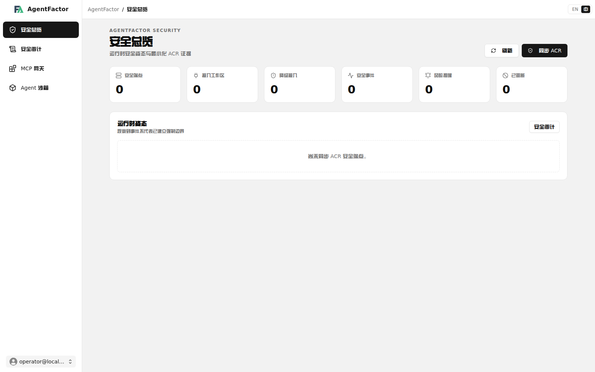
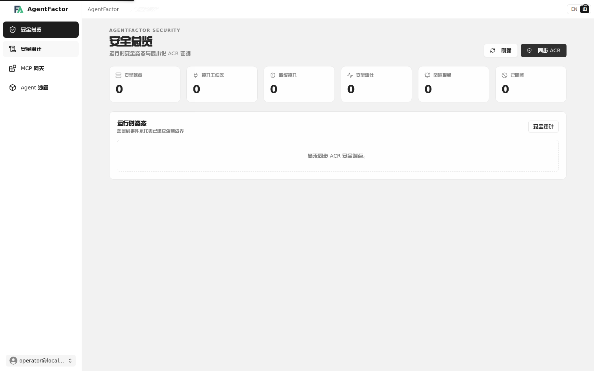
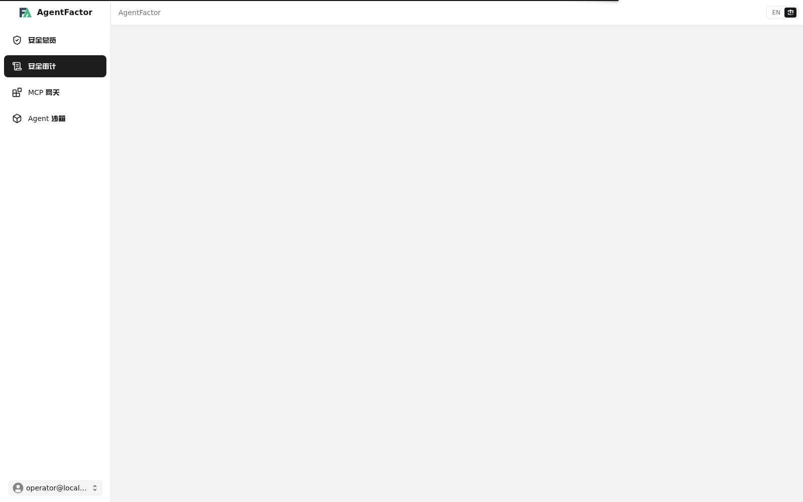
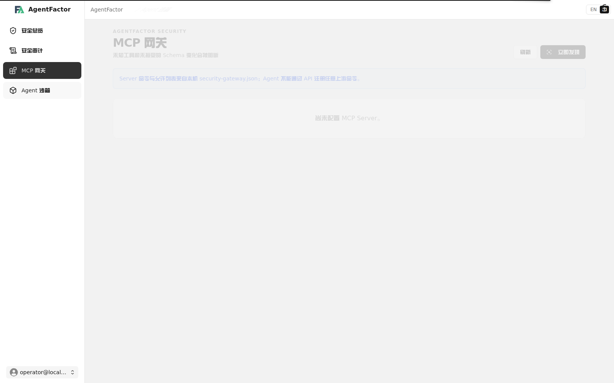
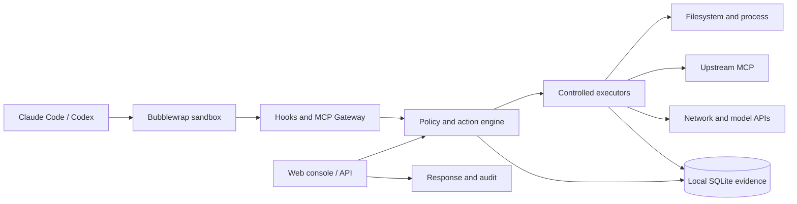

# AgentFactor

**本地优先的 AI Agent 安全控制与可观测平台。**  
**A local-first security control and observability platform for AI agents.**

[中文](#中文) · [English](#english)

AgentFactor 在 Claude Code、OpenAI Codex 等 Agent 与本机工具、MCP Server、网络和模型服务之间建立可验证的安全边界。它不替代 Agent 自身的任务规划与多 Agent 编排，而是集中提供沙箱隔离、策略决策、受控执行、数据流保护和审计证据。

AgentFactor places verifiable security boundaries between agents such as Claude Code and OpenAI Codex and local tools, MCP servers, networks, and model services. It does not replace an agent's own planning or multi-agent orchestration; it provides centralized sandboxing, policy decisions, controlled execution, data-flow protection, and audit evidence.

> **项目状态 / Project status:** AgentFactor 仍处于实验阶段并在积极开发中。API、安全能力和控制台流程在稳定版本发布前可能发生变化。AgentFactor is experimental and under active development. APIs, security capabilities, and dashboard workflows may change before a stable release.



## 中文

### 为什么选择 AgentFactor？

AI Agent 已经能够在项目中自主规划、调用工具并组织子任务，但它们使用的权限通常直接继承自宿主环境。AgentFactor 关注的不是再次实现一套编排系统，而是回答这些问题：

- Agent 实际拥有哪些文件、进程、MCP、网络和模型访问能力？
- 高风险动作是被记录、提醒还是在执行前阻断？
- 工具参数、工作目录或策略发生变化后，旧授权是否仍然有效？
- 敏感数据是否可能流向未经授权的 MCP、网络或模型端点？
- 发生异常后，操作者能否获得可验证、可导出的最小化证据？

### 功能亮点

#### Agent 沙箱

Claude Code 与 Codex 可通过 fail-closed 的 Bubblewrap launcher 启动。工作区保持可写，宿主根文件系统只读，未声明的 Home 目录和 AgentFactor 控制数据默认不可见，并使用独立的 PID、IPC、UTS、Home、tmp 和 runtime 环境。

#### 策略与动作控制

规范化 Action 将 principal、Agent、项目、会话、工作目录、工具参数、资源和当前策略摘要绑定在一起。策略通过 `record`、`remind`、`block` 三种结果决定动作是否执行；允许的动作使用 60 秒、一次性且不可重放的 Execution Grant。

#### MCP Gateway

Agent 通过统一安全入口访问上游 MCP Server。Gateway 执行 Server/tool allowlist、JSON Schema 参数校验和 schema digest 固定；工具定义发生未授权变化时会在转发调用前阻断。

#### 受控网络、模型与凭据

Native Executor 为文件、进程、MCP、网络和模型操作提供逐次执行边界。网络请求逐跳校验协议、域名、端口、解析 IP 和重定向；模型凭据由服务端 Credential Broker 注入，不返回给 Agent，也不写入审计库。

#### 数据流与审计

资源可标记为 `public`、`internal`、`source-code`、`pii`、`credential` 或 `untrusted-content`。敏感读取会形成 session taint，未经允许的 MCP、网络和模型出口会在上游调用前被拒绝。安全决策、响应动作和最小化审计事件可保存在本地并导出到 OTLP/SIEM。

### 产品界面

#### 安全审计

统一查看 Gateway 决策、ACR 事件、风险提醒、策略结果、证据摘要与关联 ID，不保留原始工具参数。



#### MCP 资产

发现受控 MCP Server 和工具，固定输入 Schema，并阻断未知工具或未经接受的 Schema 变化。



#### Agent 沙箱

查看每个公共 Agent 会话实际获得的隔离能力和 `NOT_ENFORCED` 边界，避免把“已配置”误报为“已强制执行”。



### 工作方式



公共 Agent 通过 tmux 保持交互式会话生命周期，但任务规划和协作仍由 Agent 自身负责。AgentFactor 在外围声明并验证安全能力：沙箱限制宿主访问，Hook 与 Gateway 观察或阻断动作，Native Executor 为主动接入的应用提供更细粒度的执行边界。

### 安全保证边界

AgentFactor 会按实际证据区分 `SANDBOX_ENFORCED`、`HOOK_ENFORCED`、`GATEWAY_ENFORCED`、`EXECUTOR_ENFORCED`、`OBSERVED` 和 `NOT_ENFORCED`，不会因为某项能力已配置就宣称端到端强制执行。

- Linux/WSL 上的公共 Agent 沙箱可以阻止工作区外的宿主持久写入；第一版仍共享网络，因此不宣称公共 Agent 已实现网络隔离。
- Native SDK 是调用入口，Executor 才是执行边界。Agent 绕过 SDK 直接使用宿主能力时，该动作不受 Native Executor 强制保护。
- Codex 在严格配置下可以只暴露受控 MCP 入口；Claude Code 当前存在不可移除的厂商内置 MCP，因此严格档位会 fail-closed。
- AgentFactor 是安全控制层，不是操作系统级安全边界的替代品。生产部署仍应使用最小权限凭据、主机隔离、备份和独立的网络控制。

详细说明请参阅 [Security Gateway](docs/security-gateway.md) 和 [Public Agent Sandbox](docs/public-agent-sandbox.md)。

### 环境要求

- Python 3.11+
- Linux，或 Windows 上的 WSL
- tmux 3.x
- [uv](https://docs.astral.sh/uv/)
- Bubblewrap（公共 Agent 沙箱）
- 至少一个已安装并完成认证的 Agent CLI；当前重点验证 Claude Code 与 OpenAI Codex
- 修改 Web 控制台时需要 Node.js 与 pnpm

### 安装与启动

从本地 checkout 安装依赖并初始化运行目录：

```bash
uv sync
uv run agentfactor init
```

启动本地 API 与 Web 控制台：

```bash
uv run python main.py
```

打开 [http://127.0.0.1:9889/admin/#/security](http://127.0.0.1:9889/admin/#/security)。API 默认只监听 loopback。

启动一个受管理的 Codex 会话：

```bash
uv run agentfactor launch \
  --provider codex \
  --agent-profile developer \
  --working-dir "$PWD"
```

公共 Agent 默认使用兼容档位。可以显式选择档位：

```bash
AGENTFACTOR_PUBLIC_SANDBOX_PROFILE=public-agent-compatibility \
  uv run agentfactor launch --provider codex --working-dir "$PWD"
```

启动面向 Agent 的安全 MCP 入口：

```bash
uv run agentfactor-security-mcp
```

### 接入方式

- **公共 Agent Adapter：** Claude Code、Codex 通过 tmux 和 Bubblewrap 进入受管理会话。
- **Security MCP Gateway：** 为 Agent 暴露受控的 MCP inventory 与通用工具调用入口。
- **Native SDK：** Python SDK 位于 `src/agentfactor/sdk/`，TypeScript SDK 位于 `sdk/typescript/`。
- **HTTP API：** 安全接口统一位于 `/security/v1alpha1/`。

### 运行数据

为兼容早期版本，本地目录目前仍使用 `.conductor` 名称：

```text
~/.conductor/
├── db/conductor.db
├── logs/terminal/
├── approvals/
└── security-gateway.json
```

策略、审计摘要、沙箱证据和运行状态默认保留在本机。不要把 `~/.conductor/` 中的数据库或配置文件暴露给 Agent 沙箱或提交到仓库。

### 开发

运行后端测试：

```bash
uv sync --dev
uv run pytest
```

构建 Web 控制台：

```bash
cd frontend_fantastic
pnpm install --frozen-lockfile
pnpm build
```

主要目录：

```text
src/agentfactor/security/      策略、Gateway、Executor、沙箱与审计
src/agentfactor/providers/     公共 Agent 适配器
src/agentfactor/sdk/           Python Native SDK
src/agentfactor/mcp_server/    MCP 服务入口
sdk/typescript/                TypeScript Native SDK
frontend_fantastic/            Web 控制台
tests/                         自动化测试
```

---

## English

### Why AgentFactor?

Modern AI agents can plan work, invoke tools, and coordinate subtasks on their own, but they often inherit the full privileges of their host environment. AgentFactor does not introduce another orchestration layer. It focuses on a different set of questions:

- What filesystem, process, MCP, network, and model capabilities does an agent actually have?
- Should a risky action be recorded, surfaced as a warning, or blocked before execution?
- Does an authorization remain valid after its arguments, working directory, resource, or policy changes?
- Can sensitive data leave through an unauthorized MCP server, network route, or model endpoint?
- Can operators retain minimal, verifiable, and exportable evidence when something goes wrong?

### Highlights

#### Agent sandboxing

Claude Code and Codex can be launched through a fail-closed Bubblewrap launcher. The workspace remains writable while the host root is read-only, undeclared home directories and AgentFactor control data stay hidden, and the agent receives isolated PID, IPC, UTS, home, tmp, and runtime environments.

#### Policy and action control

A canonical Action binds the principal, agent, project, session, working directory, tool arguments, resource, and active policy digest. Policies return `record`, `remind`, or `block`. Allowed actions receive a single-use, non-replayable Execution Grant that expires after 60 seconds.

#### MCP Gateway

Agents access upstream MCP servers through one security entry point. The gateway enforces server and tool allowlists, validates arguments with JSON Schema, pins schema digests, and blocks calls when a tool definition changes without approval.

#### Controlled network, model, and credential access

The Native Executor provides per-operation boundaries for filesystem, process, MCP, network, and model actions. Network requests validate scheme, domain, port, resolved IPs, and every redirect. Provider credentials are injected by a server-side Credential Broker and are never returned to the agent or stored in the audit database.

#### Data flow and audit

Resources can be labeled `public`, `internal`, `source-code`, `pii`, `credential`, or `untrusted-content`. Sensitive reads taint a session, and unauthorized MCP, network, or model egress is rejected before the upstream call. Security decisions, response actions, and minimized audit events remain local and can be exported to OTLP/SIEM.

### Product tour

- **Security overview:** current endpoints, capability posture, events, alerts, and enforcement state in one view. See the [security overview screenshot](docs/images/security-overview.png).
- **Security audit:** gateway decisions, ACR events, risk alerts, policy results, evidence digests, and correlation IDs without retaining raw tool arguments. See [security audit](docs/images/security-decisions.png).
- **MCP inventory:** discover controlled servers and tools, pin input schemas, and detect tool-definition changes. See [MCP inventory](docs/images/security-mcp.png).
- **Agent sandboxes:** inspect the isolation evidence and explicit `NOT_ENFORCED` boundaries of each public-agent session. See [agent sandboxes](docs/images/security-sandboxes.png).

### How it works

Public agents use tmux for their interactive session lifecycle, while planning and collaboration remain the agent's responsibility. AgentFactor declares and verifies the surrounding security capabilities: the sandbox constrains host access, hooks and gateways observe or block actions, and the Native Executor gives integrated applications finer-grained execution boundaries.

### Security boundaries

AgentFactor reports what the available evidence supports: `SANDBOX_ENFORCED`, `HOOK_ENFORCED`, `GATEWAY_ENFORCED`, `EXECUTOR_ENFORCED`, `OBSERVED`, or `NOT_ENFORCED`. A configured integration is not automatically presented as end-to-end enforcement.

- On Linux/WSL, the public-agent sandbox blocks persistent host writes outside the workspace. Its first version shares the host network and therefore does not claim network isolation.
- The Native SDK is an entry point; the Executor is the enforcement boundary. Direct host access that bypasses the SDK is not protected by the Native Executor.
- Codex can expose only controlled MCP entry points in strict mode. Claude Code currently retains a vendor-provided MCP connection that cannot be removed, so strict mode fails closed.
- AgentFactor is a security control layer, not a replacement for operating-system isolation. Production use still requires least-privilege credentials, host isolation, backups, and independent network controls.

Read [Security Gateway](docs/security-gateway.md) and [Public Agent Sandbox](docs/public-agent-sandbox.md) for the detailed guarantees and limitations.

### Requirements

- Python 3.11+
- Linux, or WSL on Windows
- tmux 3.x
- [uv](https://docs.astral.sh/uv/)
- Bubblewrap for public-agent sandboxing
- At least one installed and authenticated agent CLI; Claude Code and OpenAI Codex are the primary validated integrations
- Node.js and pnpm when changing the web console

### Install and run

Install dependencies and initialize the local runtime:

```bash
uv sync
uv run agentfactor init
```

Start the local API and web console:

```bash
uv run python main.py
```

Open [http://127.0.0.1:9889/admin/#/security](http://127.0.0.1:9889/admin/#/security). The API binds to loopback by default.

Launch a managed Codex session:

```bash
uv run agentfactor launch \
  --provider codex \
  --agent-profile developer \
  --working-dir "$PWD"
```

Public agents use the compatibility profile by default. Select it explicitly when needed:

```bash
AGENTFACTOR_PUBLIC_SANDBOX_PROFILE=public-agent-compatibility \
  uv run agentfactor launch --provider codex --working-dir "$PWD"
```

Start the agent-facing security MCP entry point:

```bash
uv run agentfactor-security-mcp
```

### Integration modes

- **Public-agent adapters:** Claude Code and Codex run in managed tmux and Bubblewrap sessions.
- **Security MCP Gateway:** exposes controlled MCP inventory and generic tool calls to agents.
- **Native SDK:** the Python SDK lives in `src/agentfactor/sdk/`; the TypeScript SDK lives in `sdk/typescript/`.
- **HTTP API:** security endpoints share the `/security/v1alpha1/` prefix.

### Local data

The local directory still uses the legacy `.conductor` name for compatibility:

```text
~/.conductor/
├── db/conductor.db
├── logs/terminal/
├── approvals/
└── security-gateway.json
```

Policies, audit digests, sandbox evidence, and runtime state stay local by default. Do not expose the database or configuration files under `~/.conductor/` to an agent sandbox or commit them to a repository.

### Development

Run backend tests:

```bash
uv sync --dev
uv run pytest
```

Build the web console:

```bash
cd frontend_fantastic
pnpm install --frozen-lockfile
pnpm build
```

Repository layout:

```text
src/agentfactor/security/      Policies, gateways, executors, sandbox, and audit
src/agentfactor/providers/     Public-agent adapters
src/agentfactor/sdk/           Python Native SDK
src/agentfactor/mcp_server/    MCP server entry points
sdk/typescript/                TypeScript Native SDK
frontend_fantastic/            Web console
tests/                         Automated tests
```

## Third-party notice

The dashboard in `frontend_fantastic/` is based on Fantastic-admin and retains Fantastic-admin package names for its internal workspace modules. Fantastic-admin is distributed under the MIT License; see [frontend_fantastic/LICENSE](frontend_fantastic/LICENSE).

References to third-party tools, models, and platforms describe compatibility only. AgentFactor is not affiliated with, endorsed by, or sponsored by those providers unless explicitly stated.

## License

AgentFactor is released under the GNU General Public License v3.0. See [LICENSE](LICENSE). Contributions are welcome when they can be distributed under the same license.
